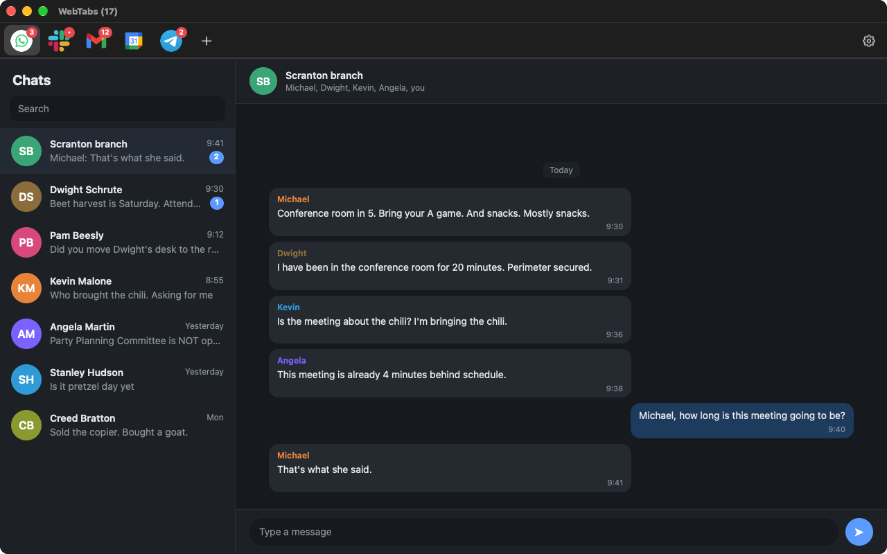
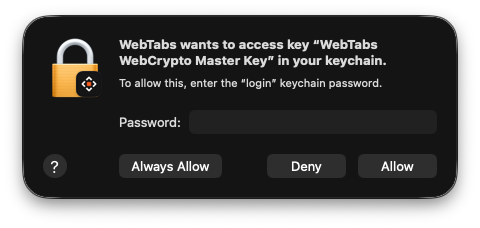

<div align="center">


# WebTabs

**Pinned web apps in a native window.**

macOS · Windows · Linux — built in Rust.<br>
WhatsApp, Slack, Gmail and your own tools as tabs, with unread counts and
notifications. No Electron.

   

[Download](#download) · [Features](#features) · [Using WebTabs](#using-webtabs) · [Development](docs/DEVELOPMENT.md) · [License](#license)



</div>

## Features

- **Native and small:** the system web engine (WebKit or WebView2), not a bundled Chromium.
- **Unread counts and notifications:** on each tab, the title, tray and Dock; mute any tab.
- **Two accounts, one service:** *isolated login* gives a tab its own cookies.
- **Safe defaults:** other sites open in your browser; permissions stay per site.
- **Tray and one config file:** runs in the background; `tabs.toml` applies live.

## Download

Get the files from the [latest release](https://github.com/ivanm/webtabs/releases/latest).

### macOS (14+)

1. Download **`WebTabs-macOS.zip`**, unzip it, and move **WebTabs** to **Applications**.
2. Open WebTabs. macOS blocks it the first time because it isn't notarized yet. Click **Done**.
3. Go to **System Settings › Privacy & Security** and click **Open Anyway** next to WebTabs.
4. When asked for your keychain password, choose **Always Allow**.

> [!IMPORTANT]
> **On macOS, choose *Always Allow* when WebTabs asks for your login keychain
> password.** WebTabs needs the *WebTabs WebCrypto Master Key*, WebKit's key for
> the encrypted data sites store (web crypto keys, some logins). The key stays in
> your login keychain. After *Always Allow* it won't ask again. It asks once more
> if a differently signed copy of WebTabs (for example, your own build) has used
> the key since.
>
> 

### Windows (10 22H2+ / 11)

1. Download **`WebTabs-<version>-windows-x64.msi`**. If the browser warns, choose **Keep**.
2. Open it. If *Windows protected your PC* appears, click **More info › Run anyway**. It's not code-signed yet.
3. It installs for your account only, with no admin prompt. Open **WebTabs** from Start.

Updates: open a newer `.msi`. Portable instead: extract **`webtabs-<version>-windows-x64.zip`** and run `webtabs.exe`.

### Linux (x86_64)

- **Ubuntu 24.04+ / Debian 13+:** download **`webtabs_<version>_amd64.deb`**, then `sudo apt install ./webtabs_*_amd64.deb`
- **Arch:** download **`webtabs-<version>-1-x86_64.pkg.tar.zst`**, then `sudo pacman -U webtabs-*.pkg.tar.zst`
- **Any other distro:** download **`webtabs-<version>-linux-x86_64.tar.gz`**, then `tar xzf webtabs-*.tar.gz && webtabs-*/install.sh`

Then open **WebTabs** from your app menu.

<details>
<summary><b>Linux: requirements, removal and building from source</b></summary>

WebTabs needs `webkit2gtk-4.1`, `gtk3` and `libayatana-appindicator` (the .deb
and Arch packages pull these in), plus GStreamer's good/bad/libav plugins for
media and calls.

- **Tarball:** installs into `~/.local`; use `PREFIX=/usr/local` with sudo for
  everyone. Remove with `install.sh --uninstall`.
- **.deb / Arch:** removed like any other package (`apt remove webtabs`,
  `pacman -R webtabs`).
- **From source:** `make install` (see [docs/DEVELOPMENT.md](docs/DEVELOPMENT.md)).

</details>

Uninstalling never deletes your tabs or logins.

## Using WebTabs

Add a tab with **+**, right-click a tab to reload, edit, move or remove it, and
open **Settings** with the gear.

<details>
<summary><b>Tabs and settings</b></summary>

**Add a tab** with **+**: pick WhatsApp, Slack, Telegram or Gmail in one click, or
paste any URL. Optionally give it a short **icon tag** (like `W2`) to tell similar
tabs apart, mute its notifications, or turn on **isolated login** for a second
account. Several Slack *workspaces* on one account don't need it; switch between
them inside Slack.

**Manage tabs** by right-clicking one (reload, edit, move, remove) or open
**Settings** with the gear:

| Setting | What it does |
|---|---|
| Start with computer | Opens hidden in the tray when you log in |
| Show notifications | Desktop notifications from your tabs |
| Show icon in tray | Unread indicator and quick menu |
| Close to tray | Closing the window keeps WebTabs running |
| Unread count in window title | e.g. "WebTabs (5)" |
| Unread count on Dock / launcher icon | macOS Dock; Linux docks that support badges (KDE, Dash to Dock, Plank) |
| GPU acceleration | Linux and Windows; turn off only if pages render wrong. Applies after a restart |

Settings also lists your tabs to reorder, mute, edit or remove. On macOS,
*Appearance* sets the tab icon size and the title bar color.

</details>

<details>
<summary><b>The config file: <code>tabs.toml</code></b></summary>

| Platform | Location |
|---|---|
| Linux | `~/.config/webtabs/tabs.toml` |
| macOS | `~/Library/Application Support/webtabs/tabs.toml` |
| Windows | `%APPDATA%\webtabs\tabs.toml` |

```toml
notifications = true
tray = true
close_to_tray = true
unread_in_title = true
unread_in_dock = true            # macOS Dock / Linux launcher icon
# gpu_acceleration = false       # Linux/Windows: draw pages on the CPU
# icon_size = 28                 # tab icons, 16–32 pt (default 22)
# tint = "sage"                  # tab bar: graphite, sand, sage, sky, lavender, rose or "#rrggbb"
# user_agent = "..."             # override for every tab

[[tab]]
name = "WhatsApp"
url = "https://web.whatsapp.com"
notifications = false            # muted (the badge still shows)
label = "W"                      # 1–2 letter tag on the icon
session = "whatsapp-2"           # isolated login

[[tab]]
name = "Grafana"
url = "https://grafana.example.com"
user_agent = "..."               # this tab only
```

Save the file and WebTabs applies it immediately. Tabs whose URL didn't change
keep running, logged in. A file with a mistake is ignored (you get a
notification) until you fix it. Removing an isolated tab deletes its login data.

</details>

<details>
<summary><b>Keyboard shortcuts</b></summary>

| Linux · Windows | macOS | Action |
|---|---|---|
| Ctrl+1…8 · Ctrl+9 | ⌘1…8 · ⌘9 | Go to tab N · last tab |
| Ctrl+Tab · Ctrl+Shift+Tab | ⌃Tab · ⌃⇧Tab | Next · previous tab |
| Ctrl+T | ⌘T | Add tab |
| Ctrl+E ¹ | ⌘E | Edit current tab |
| Ctrl+, | ⌘, | Settings |
| Ctrl+R · F5 | ⌘R | Reload |
| Alt+← · Alt+→ · Alt+Home | ⌘[ · ⌘] · ⇧⌘H | Back · forward · tab's home page |
| Ctrl+= · Ctrl+- · Ctrl+0 | ⌘+ · ⌘- · ⌘0 | Zoom in · out · reset |
| Ctrl+W · Ctrl+Q | ⌘W · ⌘Q | Hide to tray · quit |
| F12 | Right-click › Inspect Element | Web inspector |

Middle-click a tab to reload it. ¹ Linux and macOS.

</details>

<details>
<summary><b>Good to know</b></summary>

- **Unread counts** come from page titles like `(3) WhatsApp` or `Inbox (12)`.
- **Fullscreen video** (YouTube, Meet) fills the screen on Linux and macOS; Escape
  or switching tabs brings the tab bar back.
- **Crashes:** a crashed tab reloads itself, at most three times a minute.
- **Notifications on macOS** show only once WebTabs is allowed them in System
  Settings › Notifications. Service-worker push notifications aren't supported.

</details>

## Development

A Rust core with a native front end per platform; see
**[docs/DEVELOPMENT.md](docs/DEVELOPMENT.md)**.

## License

Copyright © 2026 Ivan Mayoral and WebTabs contributors.

WebTabs is free software under the [GNU General Public License v3.0 or later](LICENSE).
You may use, share and change it. If you distribute a modified version, you must
release its source under the same license.
